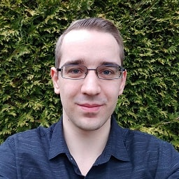
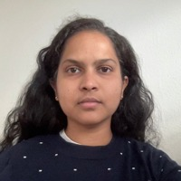
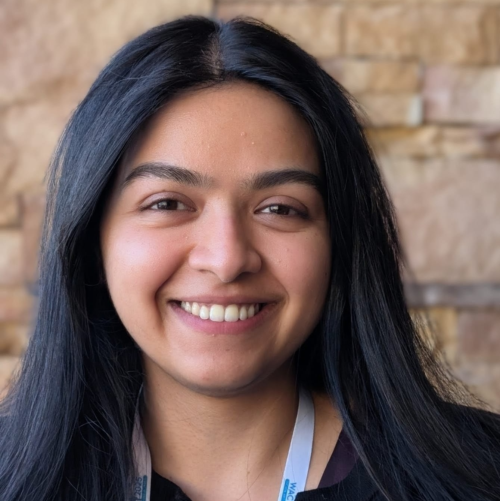
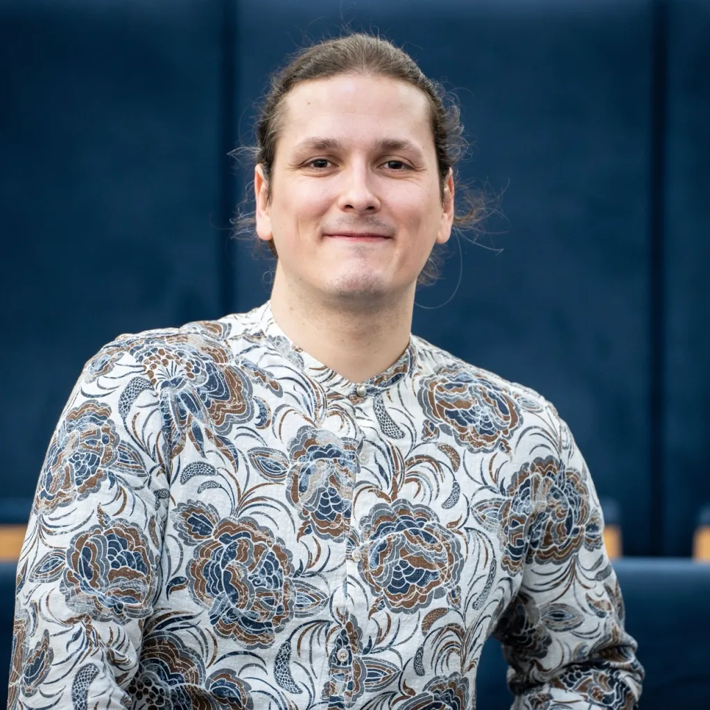
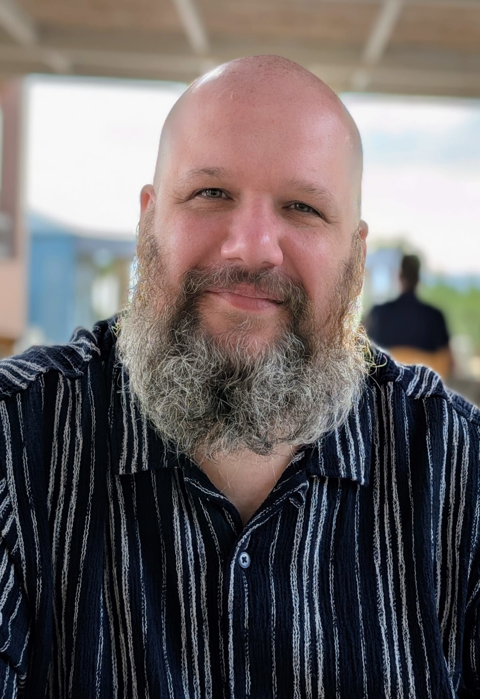
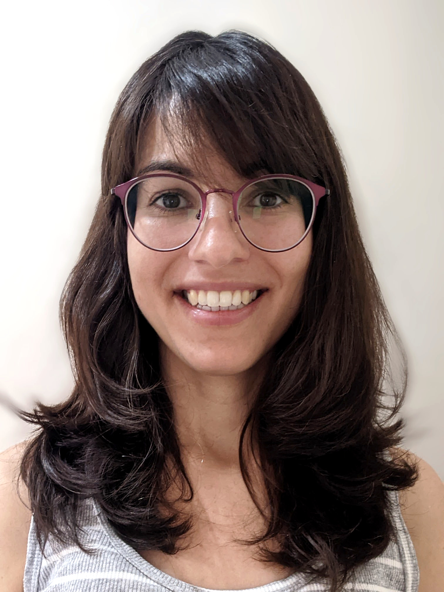
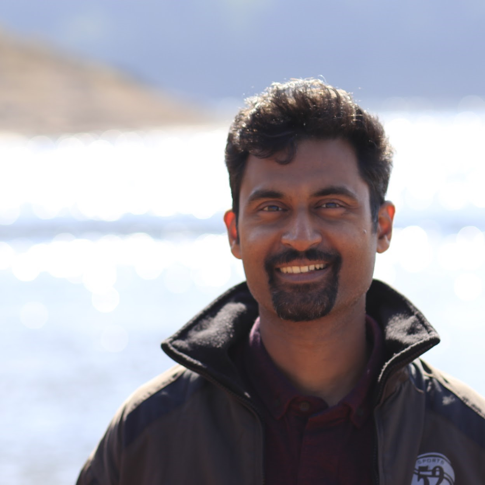

 

# Organizers

| <a href="https://ml-research.github.io/people/fbusch/index.html">Florian Busch</a> | <a href="https://ml-research.github.io/people/rkamath/index.html">Roshni Kamath</a> | <a href="https://ml-research.github.io/people/nhegde/index.html">Niharika Hegde</a> |
| :----------------------------------------------------------: | :----------------------------------------------------------: | :----------------------------------------------------------: |
| {: .align-center .organizer-photo} | {: .align-center .organizer-photo} | {: .align-center .organizer-photo} |
|                 :-------------------------:                  |                 :-------------------------:                  |                 :-------------------------:                  |
|                         PhD Student                          |                         PhD Student                          |                         PhD Student                          |
|                 :-------------------------:                  |                 :-------------------------:                  |                 :-------------------------:                  |
|                  TU Darmstadt & hessian.AI                   |                  TU Darmstadt & hessian.AI                   |                      DFKI & TU Darmstadt                      |

| <a href="https://owl-ml.com/people/mundt/">Martin Mundt</a>  | <a href="https://sites.google.com/view/razp/home">Razvan Pascanu</a> |    <a href="https://causxai.github.io/">Adèle Ribeiro</a>    | <a href="https://sites.google.com/site/pksrijith/home">Srijith P.K</a> |
| :----------------------------------------------------------: | :----------------------------------------------------------: | :----------------------------------------------------------: | :----------------------------------------------------------: |
| {: .align-center .organizer-photo} | {: .align-center .organizer-photo} | {: .align-center .organizer-photo} | {: .align-center .organizer-photo} |
|                 :-------------------------:                  |                 :-------------------------:                  |                 :-------------------------:                  |                 :-------------------------:                  |
|                        Full Professor                        |                      Research Scientist                      |                          Professor                           |                     Associate Professor                      |
|                 :-------------------------:                  |                 :-------------------------:                  |                 :-------------------------:                  |                 :-------------------------:                  |
|                     University of Bremen                     |                        DeepMind & MILA                        |                         RWTH Aachen                          |                        IIT Hyderabad                         |
