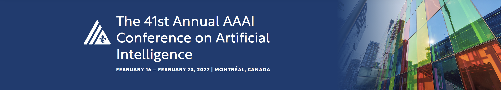

# Continual Causality

## 4th Bridge Program at AAAI 2027: February 17

{: .align-center style="width:1900px;"}

**Continual Causality is back for round 4!**

#### Key Dates

> Submission deadline (novel work; 2 pages or 4 pages): **December 1, 2026** (AoE) - [submit via OpenReview](https://openreview.net/group?id=AAAI.org/2027/Bridge/Continual_Causality_Novel)

> Submission deadline (previously published work): **January 8, 2027** (AoE) - [submit via OpenReview](https://openreview.net/group?id=AAAI.org/2027/Bridge/Continual_Causality_Previously_Published)

> Bridge: **February 17, 2027**

See the [call for participation](https://www.continualcausality.com/cfp/) for details.

#### Bridge Overview

The recurring [AAAI-27 bridge program](https://aaai.org/conference/aaai/aaai-27/) brings together the continual learning and causality communities. Both fields tackle important challenges in artificial intelligence involving learning and reasoning in complex, dynamic environments.

Building on the previous editions, the fourth bridge focuses on how learning systems can continually build and maintain accurate causal world models when the world is non-stationary and only partially observed. The program will include an overview of continual causality research, a tutorial, invited vision talks, a poster session based on contributed submissions, a panel discussion, and interactive community breakout sessions. All materials will be made publicly available, and we will synthesize the key ideas, challenges, and opportunities to support ongoing exchange beyond AAAI-27.

* More information is provided in the [bridge format section](https://www.continualcausality.com/format/).
* The [call for participation](https://www.continualcausality.com/cfp/) explains how to contribute to the bridge.
* Schedule and speaker information can be found under the [program tab](https://www.continualcausality.com/program/).
* Join our community on [Slack](https://join.slack.com/t/continualcausality/shared_invite/zt-1fwahodl3-7Z8xe_lzxj33qEbTs558kg).
* Email info[at]continualcausality[dot]com with questions.

#### Bridge Perspectives and Areas of Focus

To learn successfully in natural settings, a machine learning agent must accommodate complex, non-linear dynamics amid apparent stochasticity. Success beyond the training distribution requires more than modeling statistical dependencies and temporal dynamics: it also requires understanding the causal mechanisms that generate those dependencies.

Causality provides a language and a set of algorithms for discovering and inferring cause-and-effect relationships from observational and experimental data. It supports learning partial representations of causal models, evaluating unrealized interventions, reasoning about stochastic policies, generalizing causal knowledge to target populations, recovering from selection bias, and deriving counterfactual explanations. Causal structure and invariances are also increasingly important when data distributions shift continuously.

Continual learning systems learn from a stream of data over time, enabling knowledge transfer while mitigating interference as data distributions change. They do so without repeatedly revisiting previously encountered training samples, unless those samples are retained in memory.

These fields provide complementary capabilities that are increasingly central to world modeling and autonomous agents. As information and data distributions evolve, continual integration of causal knowledge is necessary for navigating novel environments and generalizing reliably to new problems.

#### Bridge Goals: Challenges and Opportunities

Causal learning tools can suffer catastrophic interference between past-learned, possibly imperfect representations and new data. Learning dynamic and potentially out-of-equilibrium causal models from a continuous stream is therefore challenging. Existing approaches to transferring causal knowledge across domains often assume sufficient background knowledge about which features are shared, while causal discovery methods that exploit non-stationarity commonly assume that all data are available at once.

Continual learning can reduce the fragility of causal models under distribution shift when information is only partially available, and can use the temporal structure of the data stream. At the same time, causal methods can identify stable mechanisms behind a stream of observations, supporting more reliable decision-making and a clearer understanding of what continual models learn.

These questions are increasingly important for large-scale models trained on data collected at different times and under different conditions, and later updated through continual pretraining, fine-tuning, or retrieval. In this edition, we broaden the program from the intersection of two fields to a shared question:

> How can learning systems build and maintain accurate models of a world that changes over time and is only partially observed?

#### Bridge Outline

The bridge will explore the following research questions:

1. How can knowledge integration, unlearning, and contextualization be defined when causal models are learned from a continuous, non-stationary stream?
2. How capable are foundation models of bridging causal and continual learning, and to what extent are they limited by continued reasoning and adaptation?
3. How can causal structure help continual learning systems leverage accumulated knowledge and interpret distributional shifts?
4. What novel continual causality methods, positions, datasets, and applications should be developed?

#### Community

Researchers, students, and practitioners interested in causality and continual learning are invited to contribute. Participants may submit short contributions and present accepted conference and journal papers related to the bridge theme in the poster session. Together with the invited talks and panel discussion, these contributions will form the basis for interactive breakout discussions and collaborations beyond AAAI-27.
