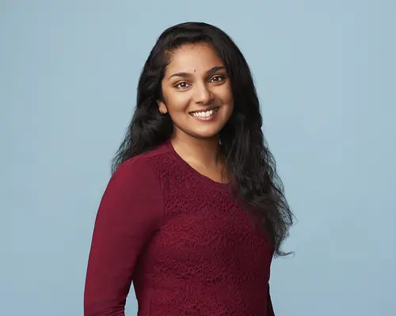
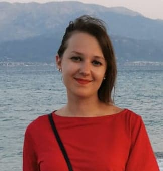
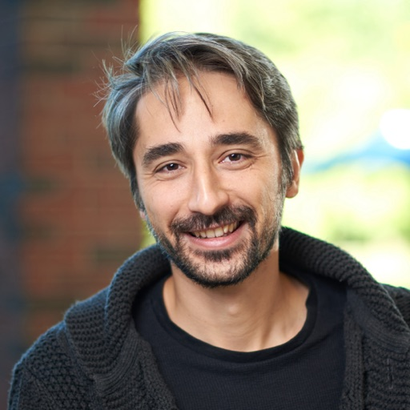
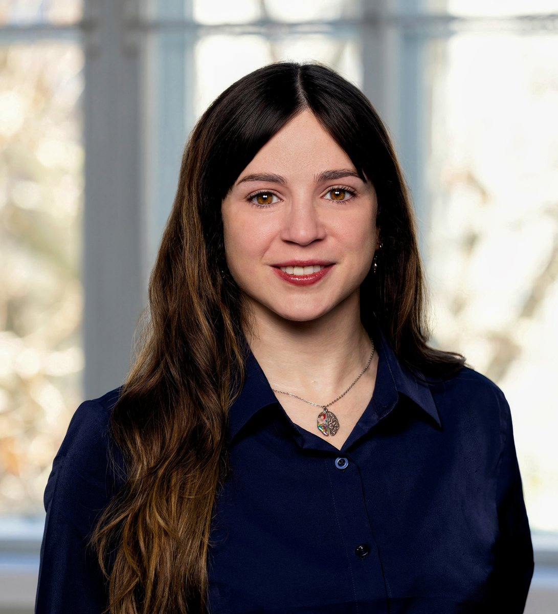

 

# Program

The bridge's program will span activities from a tutorial and invited vision talks, to a poster session, an interactive panel and breakout discussions.

The program can be found below:

All times are in Eastern Standard Time (EST, UTC-5)

#### February 16th or 17th

* 9:00: Bridge kickoff - Organizers (10 min)
* 9:10: Tutorial: Causality and continual learning (45 min)
* 9:55: Invited vision talk (30 min + 10 min Q&A)
* 10:35: Coffee break (15 min)
* 10:50: Invited vision talk (30 min + 10 min Q&A)
* 11:30: Interactive discussion on specific topics, e.g., agentic AI and world models (40 min)
* 12:10: Lunch break (80 min)
* 13:30: Invited vision talk (30 min + 10 min Q&A)
* 14:10: Invited vision talk (30 min + 10 min Q&A)
* 14:50: Interactive discussion on future challenges (40 min)
* 15:30: Poster session with coffee break (60 min)
* 16:30: Panel discussion and concluding remarks (60 min)
* 17:30: Bridge wrap-up

## Invited Speakers

{: .align-left style="width:250px;"}
[Dhanya Sridhar](https://www.dsridhar.com/) - University of Montreal & Mila  
Dhanya Sridhar is an assistant professor in the department of Informatics and Operations Research (DIRO) at Université de Montréal and a core academic member of Mila - Quebec Artificial Intelligence Institute.  She receives support as a Canada CIFAR AI Chair and co-leads the IVADO R3AI working group on safe and aligned AI. Her research focuses on combining causality and machine learning in service of AI systems that are robust to distribution shifts, adapt to new tasks efficiently, and discover new knowledge alongside us.  This large vision includes learning causal representations to interpret complex and unstructured data with limited human supervision, predictors that learn causal mechanisms to remain robust, interpreting large AI systems with causal abstraction, understanding and improving new learning paradigms like in-context learning, and aspects of responsible AI.  

{: .align-left style="width:250px;"}
[Eleni Triantafillou](https://elenitriantafillou.github.io/) - Google DeepMind  
Eleni Triantafillou is a senior research scientist at Google DeepMind, based in London UK. Her main research interest is around creating methods that allow efficient and effective adaptation of deep neural networks to cope with distribution shifts, rapidly learning new tasks, and supporting efficient unlearning of data points. Her research falls in the areas of few-shot learning, meta-learning, domain adaptation and machine unlearning.   

{: .align-left style="width:250px;"}
[Murat Kocaoglu](https://www.muratkocaoglu.com/) - Johns Hopkins University  
Murat Kocaoglu is an Assistant Professor in the Computer Science Department at Johns Hopkins University. His research focuses on developing fundamental causal inference and causal discovery algorithms and integrating them into causal machine learning solutions. He is a member of the Johns Hopkins Data Science and AI Institute (DSAI).  

{: .align-left style="width:250px;"}
[Camila González](https://riic.ai/) - Medical University of Vienna  
Camila González is a tenure-track Assistant Professor at the Medical University of Vienna and the Principal Investigator of the Representational Intelligence for Intensive Care (RIIC) lab, which develops machine learning applications for intensive care and perioperative medicine. She completed her PhD at the Technical University of Darmstadt and worked as a Postdoctoral Researcher at Stanford, where she focused on dynamic learning and monitoring for clinical settings with ongoing data collection. Her research has received multiple distinctions, including the MICCAI Young Scientist Award, the François Erbsmann Award at the IPMI conference, the BVM Award from the German Conference on Medical Image Computing, and the Freunde der TU Darmstadt Award for Outstanding Scientific Achievements. Her work has been featured in outlets such as Computer Vision News and the AI-Ready Healthcare podcast. Beyond her research, Camila has served as president of the MICCAI Student Board for two years and Career Development & Student Chair for MICCAI 2026. She is also a board member of the ContinualAI research society and webinar chair for IEEE EMBC.  

